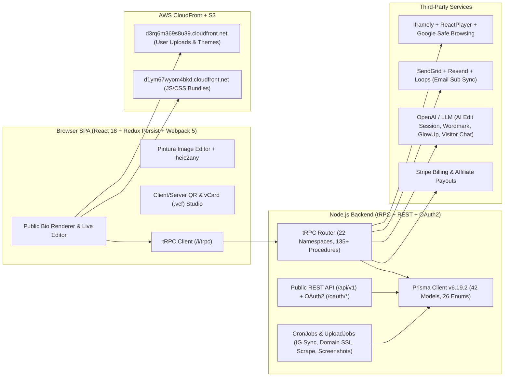
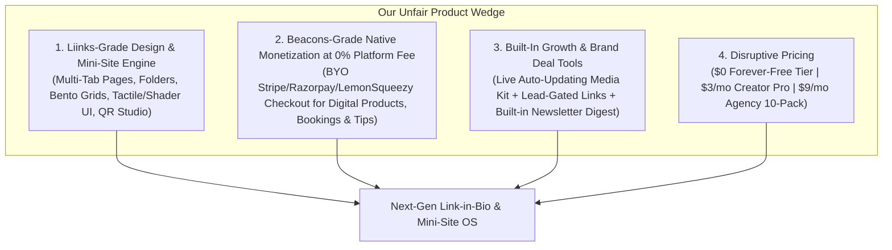
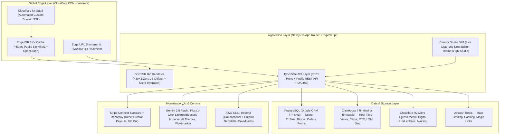

# Link-in-Bio Competitive Intelligence, REA Reverse-Engineering (`liinks.co`), & Product Blueprint

> [!IMPORTANT]
> **Executive Verdict**
> - **Best Overall for Creator Monetization & All-in-One Business Tools:** **Beacons.ai** (native digital storefront, courses, appointments, auto-updating live Media Kit, invoicing, built-in Email Marketing CRM, and social Auto-DMs).
> - **Best Overall for Visual Design Craft, Mini-Site Organization & Agency Multi-Profile Value:** **Liinks.co** (16 link layouts, 17 block types, tactile/glassmorphism buttons, shader backgrounds, AI Wordmark/GlowUp/AI Edit Session, folders + multi-tab pages, dynamic QR Studio, Public REST API + OAuth2, and 5 profiles + custom domains for \$12/mo).
> - **Best for Third-Party App Ecosystem & Brand Recognition:** **Linktree** (40+ Link Apps, Shopify/Fourthwall/Kajabi integrations, and massive consumer trust—but heavily paywalled design controls and steep \$15–\$35/mo pricing).

---

## Part 1: REA Reverse-Engineering of `https://www.liinks.co/`

### 1.1 REA Evidence Ledger & Methodology
Following the Reverse Engineer Anything (REA) runtime and static JavaScript workflows, we inspected `https://www.liinks.co/` across live Chromium CDP sessions and static AST bundle analysis:

| REA Tool | Evidence ID | Scope & Target | Key Evidence Extracted |
| :--- | :--- | :--- | :--- |
| `list_browser_targets` | `ev_17f92c811ba43a19287265568055bea131477667969bf98723d8a2ddadd6577e` | `http://127.0.0.1:9222` (Target `CA0DD812A9541575CE656BE460D9CD14`) | Attached passive CDP session to `https://www.liinks.co/` |
| `inspect_web_page` | `ev_0395059e3bf7ff34e9605ee270ccfb78de862130543bd2457dc0f7228e377b07` | Origin + CloudFront (`d1ym67wyom4bkd.cloudfront.net`, `d3rq6m369s8u39.cloudfront.net`) | Captured live DOM, 42 scripts, Redux Persist state (`persist:global`, `persist:root`), GTM (`G-5W2NBWRBZY`), and live interactive demo canvas |
| `analyze_web_bundle` | `ev_e833a199a73fad8483275b4cd72dcb242e682654b3de236cb3fbd72a5c23409f` | 33 entry/vendor/runtime Webpack bundles (`SENTRY_RELEASE: be874c32489880f2441d3c9f9330142cf8e7bfb0`) | Mapped Webpack chunk manifest (`chunk_map` in `runtime.e90a1cc6261649f77d13.js`), React 18, Redux, Stripe, and `/i/trpc` API layer |
| `export_web_scripts` | `ev_9150a393e1b6aa55d6e6883046489c0f53f43c84f7d426caaae77dcd1da1d524` | 33 active page scripts exported to local workspace | Materialized `default-app~feed.f3cb410b549cbce23691.js`, `defaultVendors-app~feed.4b923a219667056a67c0.js`, and `app.31cf4135a6c97483805e.js` |
| `analyze_javascript_application` | `ev_20c41ce1e783d24ae38b93f5d1a32393c77dffb5b382b7315e5b154445287cf5` | 33 exported scripts (1,511,607 bytes, 400,699 AST nodes, 764 modules) | Recovered 2,963 static findings across `default-app~feed` and `app` bundles |
| `trace_application_feature` | `ev_ef330956ef6cd962ab5bfbbea451b91dcdfa62820e5bc486b8a023b78a012c7f` | `ev_20c41ce1...` (`query: "trpc"`) | Traced `/i/trpc` client initialization, `id.*.useQuery`/`useMutation` hooks, and 49 route bindings |
| `capture_browser_scenario` | `ev_a93765f0f76ddb9fe87a856955784f80196e59cde9eb7c2b2204130125655bd0` | Navigation to `https://www.liinks.co/features` | Observed dynamic lazy chunk loading (`1357`, `9574`, `6191`) |
| `analyze_web_bundle` | `ev_d53f591d33c2c23d690733d2026cba50a6b7b18f03ef28a1716e842be25b7bd5` | `https://www.liinks.co/features` | Verified lazy feature chunks and route structure |
| `analyze_javascript_application` | `ev_371782c724d28b7ddb8cb07d3d9a9a8044025b1900401719bf68967199933a94` | 18 lazy-loaded feature/admin chunks (2,326,304 bytes, 421,766 AST nodes, 268 modules) | Recovered 2,529 findings covering QR Studio, AI Wordmark, GlowUp, Theme Editor, Public API docs, and internal competitor/churn matrices |

> [!NOTE]
> **Observation Provenance & Limitations**
> - **Runtime Observations:** Captured passively via Chromium CDP (`inspect_web_page`, `capture_browser_scenario`). No authenticated user mutations were executed against production.
> - **Static AST Observations:** Extracted from Webpack production bundles served from `https://d1ym67wyom4bkd.cloudfront.net/assets/bundles/be874c32489880f2441d3c9f9330142cf8e7bfb0/`.
> - **Limitations:** CloudFront `.js.map` source maps return `HTTP 403 Forbidden` (`source_map_fetch_failed` in `ev_e833a199...`), so module analysis relies on static AST decompilation of minified Webpack modules rather than original TypeScript source files.

---

### 1.2 Liinks.co System Architecture & Tech Stack
Static AST and runtime inspection reveal that **Liinks.co** is a monolithic React 18 SPA backed by a Node.js + **tRPC** (`/i/trpc`) + **Prisma ORM (`v6.19.2`)** backend:

---

### 1.3 Complete Prisma Database Schema Leaked in Client Bundle (`module 67367`)
Unusually, `defaultVendors-app~feed.4b923a219667056a67c0.js` (`module 67367`) bundles the entire generated `@prisma/client` runtime schema (`version: 6.19.2`), exposing all **42 database models** and **26 enums**:

#### All 42 Database Models
| Category | Prisma Models & Key Fields |
| :--- | :--- |
| **Core Identity & Profiles** | `User` (105 fields: `slug`, `displayName`, `tagline`, `bio`, `plan`, `subscriptionStatus`, `parentId`, `teamQuantity`, `theme`, `headerLayout`, `tactileLinkType`, `customStyles`, `aiChatEnabled`, `instagramAutoSync`, `mailchimpListId`, `sendgridListId`, `resendAudienceId`, `loopsMailingList`, `facebookPixelId`, `googleAnalyticsId`, `verifiedStatus`, etc.), `Session`, `Token`, `FailedLogin`, `CompletedSignup` |
| **Links & Content Blocks** | `Link` (47 fields: `linkType`, `linkLayout`, `title`, `subtitle`, `description`, `caption`, `target`, `order`, `page`, `folderId`, `isDraft`, `isArchived`, `isPinned`, `isSkip`, `unskipAt`, `publishAt`, `unpublishAt`, `clickGoal`, `bounceType`, `protectFormId`, `customFormId`, `gateFormId`, `attachedFormId`, `customStyles`, `isFullBleed`, `iconType`, `thiingsAssetId`, `calendarDisplayMode`, `faqStyle`, `resumeDisplayMode`, `testimonialsLayout`, `timelineVariant`, `quoteStyle`, `marqueeDirection`, `marqueeSpeed`, `countdownTargetDate`, `announceAutoPopup`, etc.) |
| **Forms, Gating & Leads** | `Form` (`type`, `title`, `description`, `submitButtonLabel`, `confirmationMessage`, `notifyEmail`, `fields`), `FormResponse` (`formId`, `linkId`, `userId`, `ipAddress`, `created`), `ProtectForm` (`type`: `CONFIRMATION` / `AGE` / `PASSWORD`, `minimumAge`, `password`), `EmailSub` (`email`, `userId`, `linkId`, `syncedWithMailchimp`, `syncedWithSendgrid`, `syncedWithResend`, `syncedWithLoops`) |
| **AI & Creative Assets** | `AiEditSession` (`userId`, `status`, `initialSnapshot`, `workingSnapshot`, `undoStack`, `redoStack`), `OnboardingConversation` (`messages`, `extractedState`, `pageSnapshot`, `scrapedSiteUrl`, `selectedMood`), `WordmarkGeneration` (`text`, `styleId`, `prompt`, `rawUploadId`, `processedUploadId`), `GlowUpGeneration` (`sourceUploadId`, `outputUploadId`, `prompt`), `ThiingsAsset` (`slug`, `name`, `categories`, `uploadId`), `Gpt` (`type`, `input`, `result`) |
| **Domains, Shortlinks & QR** | `Domain` (`domainName`, `userId`, `status`, `sslStatus`, `txtVerificationToken`, `targetType`: `PROFILE` / `SHORTLINKS`), `ShortLink` (`slug`, `domainId`, `destinationUrl`, `safeBrowsingVerdict`, `isActive`), `QrCode` (`targetType`, `qrType`, `shortCode`, `destinationUrl`, `moduleShape`, `eyeFrameShape`, `eyePupilShape`, `fgColorType`, `logoUploadId`, `frameStyle`) |
| **Developer Platform** | `ApiKey` (`keyHash`, `keyPrefix`, `scopes`, `rateLimitTier`, `expiresAt`), `OAuthClient` (`clientId`, `clientSecretHash`, `redirectUris`, `grantTypes`, `scopes`, `isDynamic`), `OAuthAuthorizationCode` (`codeHash`, `codeChallenge`, `codeChallengeMethod`), `ApiKeyRequest` |
| **Growth, Affiliates & Ops** | `AffiliateCommission`, `AffiliateSlugRedirect`, `AffiliatePayout`, `Campaign` (`code`, `percentOff`, `trialDays`), `SuggestionBoardItem`, `SuggestionVote`, `Upload`, `UploadJob`, `Scrape`, `Screenshot`, `Email`, `EmailPreferences`, `Notification`, `CronJob`, `Migration`, `Transfer`, `RateLimitedAction`, `Misc` |

---

### 1.4 Exhaustive Feature Inventory of `liinks.co` (From AST & tRPC Routers)

#### A. All 17 Content Block Types (`$Enums.LinkType`) & 16 Layouts (`$Enums.LinkLayout`)
1. **Standard & Visual Link Blocks (`LINK`)** — Renderable in **16 layouts**:
   - `DEFAULT`, `BUTTON`, `BUTTON_CAPTION`
   - `THUMBNAIL_BASIC`, `THUMBNAIL_BASIC_CAPTION`
   - `THUMBNAIL_HIGHLIGHT`, `THUMBNAIL_HIGHLIGHT_CAPTION`
   - `THUMBNAIL_GRID_2` (2-column Instagram-style grid), `THUMBNAIL_GRID_3` (3-column grid)
   - `BUTTON_IMAGE_BACKGROUND` (full-bleed card background)
   - `THUMBNAIL_CAROUSEL` (horizontal swipe carousel)
   - `TEXT`, `FOLDER_GROUP`, `ANNOUNCE_BANNER`, `ANNOUNCE_POPUP`, `ANNOUNCE_CARD`
2. **Collapsible Folders (`FOLDER`)** — Group related links inside expandable accordion drawers (`folderId`).
3. **Multi-Page / Multi-Tab Navigation (`page` + `pageNames` + `pageVisibility`)** — Turns a bio link into a multi-tab micro-website (e.g., *Home*, *Shop*, *Portfolio*, *Press*), with direct tab deep-linking on the Pro plan.
4. **Rich Media Embeds (`MEDIA`)** — Powered by Iframely + `react-player` (`YOUTUBE`, `SPOTIFY`, `APPLE_MUSIC`, `SOUNDCLOUD`, `TIDAL`, `VIMEO`, `TWITCH`, `TIKTOK`, `BANDCAMP`, `AUDIOMACK`) with `DEFAULT`, `COMPACT`, or `EMBED` player modes.
5. **Instagram Auto-Sync Block (`INSTAGRAM`)** — Connects or scrapes Instagram (`id.instagram.getPosts/importPosts`) and automatically imports post thumbnails + extracts URLs from Instagram post captions (`instagramAutoSync`).
6. **Lead Capture & Custom Forms (`FORM`)** — Supports `EMAIL_SIGNUP` (mailing list with native sync to **Mailchimp**, **SendGrid**, **Resend**, and **Loops**) and multi-field `CUSTOM` forms (`TEXT`, `TEXTAREA`, `EMAIL`, `PHONE`, `NUMBER`, `URL`, `DATE`, `DROPDOWN`, `CHECKBOX`) with CSV export and email notifications.
7. **Content Gating & Lock Screens (`ProtectForm` & `gateFormId`)**:
   - **Password Lock (`PASSWORD`)**, **Age Verification (`AGE`)**, or **1-Click Confirmation (`CONFIRMATION`)** via `protectFormId`.
   - **Lead-Gated Links (`gateFormId`)**: Visitors must submit an email/form before unlocking the destination URL or file download.
8. **File Downloads (`FILE_DOWNLOAD`)** — Direct hosting and download of PDFs, lookbooks, media kits, and ZIPs (`max 8 MB` standard upload).
9. **Interactive Niche Blocks (10 Specialized Blocks)**:
   - `ANNOUNCE` (Banner, Popup, or Card with `announceAutoPopup` & CTA)
   - `COUNTDOWN` (`countdownTargetDate`, `countdownExpiredAction`: `HIDE`, `SHOW_MESSAGE`, `REVEAL_LINK`)
   - `CALENDAR` (`LIST` or `COMPACT` event schedule with ticket/RSVP links)
   - `FAQ` (`ACCORDION`, `CARDS`, or `MINIMAL`)
   - `TESTIMONIALS` (`CAROUSEL`, `GRID`, `LIST`, ` SPOTLIGHT`)
   - `TIMELINE` (`ALTERNATING`, `COMPACT`, `CARDS`)
   - `RESUME` (`FULL` or `COMPACT` CV/experience block)
   - `QUOTE` (`CALLOUT`, `CARD`, `MINIMAL`)
   - `MARQUEE` (Scrolling ticker tape with speed/direction/separator controls)
   - `DIVIDER` (Custom rule styles: `SOLID`, `DASHED`, `DOTTED`, `DOUBLE`, `GRADIENT`, `FADE` + shapes: `STAR`, `HEART`, `DIAMOND`, `SPARKLE`, ` CIRCLE`, `SLASH`) & `TEXT` (Rich text markdown/HTML)
10. **80+ Social Icons (`SOCIALS` in `module 18750`)** — Supports placement at top or bottom (`socialIconsAtBottom`), including payment handles (`CashApp`, `Venmo`, `PayPal`, `Zelle`, `Revolut`, `BuyMeACoffee`, `Ko-fi`, `Patreon`) and social networks (`Instagram`, `TikTok`, `YouTube`, `Threads`, `Bluesky`, `RedNote`, `Substack`, `Discord`, `Spotify`, `Shopify`, `Gumroad`, etc.).

#### B. Visual Theme Engine & Tactile UI (`module 48393`, `89360`, `20879`)
- **4 Header Layouts:** `CLASSIC`, `BANNER`, `BUSINESS`, `HEADSHOT` + optional content sheet (`enableSheet`, `enableSheetFade`, `sheetColor`).
- **6 Background Modes:** `SOLID`, `GRADIENT`, `SPLIT`, `IMAGE` (with `scrimAmount` overlay), `ANIMATED` (WebGL/CSS shaders: `meshGradient`, `grainGradient`, `neuroNoise`), and separate `desktopBackground`.
- **6 Tactile Button Styles (`$Enums.TactileLinkType`):** `NONE`, `FLAT`, `CONCAVE`, `CONVEX`, `INSET`, `FROSTED_GLASS` (glassmorphism), plus `SOFT` or `SOLID` Neo-Brutalist shadows (`shadowRatio`), border width/radius ratios, and 7 attention animations (`TADA`, `HEAD_SHAKE`, `PULSE`, `RUBBER_BAND`, `SWING`, `JUMP`, `JELLO`).
- **Per-Block Style Overrides (`customStyles`):** Any individual block can override the page's colors, fonts, borders, and full-bleed layout.

#### C. AI Suite (Revealed via tRPC Router `module 5202`)
1. **Conversational AI Page Editor (`id.aiEditSession.start/send/undo/redo/commit/discard`)**: Chat-driven page editing with full snapshot undo/redo stacks (`AiEditSession` model).
2. **AI Onboarding & Website/IG Auto-Importer (`id.onboardingChat.send`, `id.gpt.importFromSite`, `id.gpt.importFromInstagram`)**: Scrapes an existing personal website or Instagram profile and builds a styled Liinks page automatically.
3. **AI Wordmark & Charm Studio (`id.wordmark.generate/list/select/remove` in `module 20879`)**: Generates custom 3D/illustrated title logos in 15 styles (`brush`, `diner`, `italic`, `casual`, `arched`, `nouveau`, `groovy`, `western`, `shadow`, `cutout`, `bubble`, `marker`, `ribbon`, `sticker`, `extruded`).
4. **AI Portrait "GlowUp" (`id.glowUp.generate` + `id.profilePicture.isTransparent/setBackground`)**: Background removal and AI studio portrait restyling for avatars.
5. **3D Icon Library (`id.thiings.search/popular`)**: Searchable library of 3D icon assets (`ThiingsAsset`).
6. **Visitor-Facing AI Chat Assistant (`id.assistant.newChat`, `aiChatEnabled`)**: Beta feature (Pro/Team tier) adding an AI concierge trained on the creator's bio/links so visitors can ask questions on the public page.

#### D. QR Code Studio, Shortlinks, vCard & Developer API
- **QR Code Studio (`id.qrCode.*`):** Supports both **Static** (free public tool, no watermark, PNG/SVG export) and **Dynamic** QR codes (update destination URL anytime without reprinting + scan analytics), custom module shapes (`SQUARE`, `DOT`, `ROUNDED`, `FLUID`, `DIAMOND`), custom eye shapes, gradients, center logo, and live contrast/scannability verification (`verifyDesign`).
- **Custom Domain URL Shortener (`id.shortLink.*`):** Turn a custom domain into a branded shortener with automated **Google Safe Browsing** malware/phishing checks (`safeBrowsingVerdict`).
- **Digital Business Card (`/:userSlug/vcf`):** One-tap `.vcf` (vCard 3.0) contact card download + free standalone generator (`/tools/digital-business-card`).
- **Free SEO Lead-Gen Tools (`/tools/*` in `module 98362`):** Free QR Code Generator, Free Digital Business Card Generator, and Free Open Graph / Twitter Card Debugger (`/tools/og-debugger`).
- **Public REST API & OAuth 2.0 Server (`id.apiKey.*`, `/oauth/*`):** Users can generate scoped API keys or connect OAuth2 apps/AI agents to programmatically CRUD links and profile settings.

#### E. Pricing Architecture & Internal Churn Secrets (`module 85997` & `62369`)
- **No Permanent Free Tier for New Users:** `module 85997` hardcodes `s = "2023-11-11"`. Users created after Nov 11, 2023 get a **14-day free trial**; after trial expiry, their page is unpublished unless they subscribe.
- **Starter (`PREMIUM_6`):** **\$5/mo** (\$4/mo billed annually at \$48/yr) — 1 profile, unlimited blocks, full theme customization, folders, multi-tab nav, forms, mailing list sync, dynamic QR codes, GA/FB pixels, Public REST API.
- **Pro (`TEAM_3`):** **\$12/mo** (\$10/mo billed annually at \$120/yr) — **5 profiles included** (`pagesPerUnit: 5`, +\$12/mo per additional 5 profiles), **Custom Domains** (for profile + shortlinks), **Direct Tab Linking**, **Custom Open Graph Metadata**, **Team Shared Media Library**, **Unique Client Login Links**, and **Beta Features (AI Chat)**.
- **Liinks' Own Cancellation Survey (`module 62369`) Reveals Why Users Leave:**
  - **Top Competitors Users Switch To (`COMPETITOR_OPTIONS`):** `Linktree`, `Beacons`, `Stan Store`, `My own website`.
  - **Top Missing Features (`MISSING_FEATURE_OPTIONS`):**
    1. `"Taking bookings or payments"` (Liinks has **zero native commerce/checkout**)
    2. `"Collecting emails and sending updates"` (Liinks only collects emails; it has **no built-in email newsletter sender**)
    3. `"A full website, not just links"`
    4. `"Analytics or tracking"` / `"Design or layout options"`
  - **#1 Pricing Churn Driver:** `"Too expensive"` (triggers an automated **50% off for 3 months** Stripe retention coupon via `id.billing.applyRetentionOffer`).

---

## Part 2: Side-by-Side Comparison (`Liinks.co` vs. `Linktree` vs. `Beacons.ai`)

| Feature Dimension | **Liinks.co** (`liinks.co`) | **Linktree** (`linktr.ee`) | **Beacons.ai** (`beacons.ai`) |
| :--- | :--- | :--- | :--- |
| **Core Positioning** | Design-forward mini-site & agency multi-profile builder | Industry-standard bio link with third-party Link Apps | All-in-one Creator OS (Bio + Store + Media Kit + Email CRM) |
| **Forever-Free Plan?** | **No** (14-day free trial only; legacy free ended Nov 2023) | **Yes** (Unlimited basic links, heavy branding, limited themes) | **Yes** (Unlimited links, storefront, email & media kit with limits + 9% fee) |
| **Paid Entry Plan** | **\$5/mo** (\$4/mo annual) — *Starter* | **\$8/mo** (\$6/mo annual) — *Starter* | **\$10/mo** (\$8.33/mo annual) — *Creator* |
| **Mid / Pro Plan** | **\$12/mo** (\$10/mo annual) — *Pro (Includes 5 profiles!)* | **\$15/mo** (\$12/mo annual) — *Pro (1 profile)* | **\$30/mo** (\$25/mo annual) — *Creator Plus (0% store fee)* |
| **Top / Agency Plan** | **+\$12/mo per 5 extra profiles** (\$2.40/profile) | **\$35/mo** (*Premium*) + Enterprise custom pricing | **\$100/mo** (*Creator Max*) + Agency Roster tools |
| **Custom Domain Support** | **Yes** (Included on \$12/mo Pro plan for both Bio & Shortlinks) | **No native root domain hosting** (Workarounds/Enterprise only) | **Yes** (Included on \$10/mo+ paid plans; 1 yr free domain voucher) |
| **Page Layout & Organization** | **16 layouts** (2/3-col grids, carousels, cards) + **Folders** + **Multi-Tab Navigation** | Vertical stack, collections/grids (Pro), carousels; no multi-tab nav | Modular drag-and-drop blocks, carousels, grids, and multi-page tabs |
| **Visual Customization** | **Best-in-class:** Custom fonts, gradients, shader backgrounds, 6 tactile button styles (glassmorphism/brutalist), per-block CSS overrides, 15 AI Wordmarks | Restricted on Free; custom fonts/gradients/button shapes require Starter (\$8) or Pro (\$15) | Full color/font/background video customization on Free & Paid; AI theme generator |
| **Content Block Types** | **17 native block types:** Links, Media, IG Sync, Folders, Forms, FAQ, Resume, Testimonials, Timeline, Countdown, Calendar, Quote, Marquee, Announce | **40+ Link Apps:** Music presaves, Cameo, GoFundMe, Gleam, Community SMS, Reddit, TikTok, etc. | **15+ Creator Blocks:** Storefront, Appointments, Email/SMS capture, Media embed, TikTok Shop, IG Sync, Fan Requests |
| **E-Commerce & Digital Products** | **None native** (External links or embeds only — #1 missing feature in churn survey) | **Linktree Shops & Digital Products:** Sell PDFs, courses, Shopify items, affiliate products | **Full Native Storefront:** Digital downloads, courses, memberships, 1-on-1 bookings/appointments, pay-what-you-want |
| **Platform Transaction Fees** | N/A (No native checkout) | **12% on Free**, **9% on Starter/Pro** (plus Stripe fees) | **9% on Free & \$10 Creator**; **0% on \$30/mo Creator Plus & \$100 Max** |
| **Email Marketing & CRM** | **Capture only** (`EmailSub` & custom `Form` blocks sync to Mailchimp, SendGrid, Resend, Loops) | **Capture & sync** (Mailchimp, Kit, Klaviyo, Google Sheets on Pro) | **Built-in Email Marketing & CRM:** Broadcasts, automated welcome sequences, audience tagging & segmentation |
| **Media Kit & Brand Deals** | **None** (Only static Resume/Stats blocks or PDF download) | **None native** | **Industry-Leading Live Media Kit:** Auto-syncs real-time IG/TikTok/YouTube/Twitch follower & engagement stats + AI Brand Pitch writer + Invoice generator |
| **Instagram Auto-DMs** | **None** (Only auto-imports links from IG captions) | **Yes** (Included via Instagram comment-to-DM automation) | **Yes** (Built-in IG comment/story reply Auto-DM flow) |
| **AI Capabilities** | **AI Edit Session** (chat page builder), **AI Wordmark**, **AI GlowUp** avatar, **Visitor AI Chat** (Beta), Website/IG scraper | AI bio writer & smart link copy suggestions | **Beam AI Suite:** AI product description writer, AI email generator, AI brand pitch email writer, AI theme builder |
| **QR Code System** | **Advanced QR Studio:** Dynamic QR codes, custom module/eye shapes, scannability meter, SVG/PNG | Basic QR code download (custom colors on Pro) | Standard QR code generator |
| **Developer API / OAuth** | **Yes:** Public REST API (`ApiKey`) + OAuth2 Server (`/oauth/*`) on all plans | Enterprise / Partner Link Apps only | No public user-facing REST API |

---

## Part 3: Which One Is Better Based on Features?

### 1. Overall Feature Completeness Winner: **Beacons.ai**
If you judge purely by **breadth of creator business features**, **Beacons.ai wins decisively**. It replaces 5 separate subscriptions (Link-in-bio + Gumroad/Stan Store + Calendly + Mailchimp + Canva Media Kit + Wave Invoicing):
- **Why it wins:** A creator can capture an email via an Instagram Auto-DM, send an automated email sequence, sell a \$49 digital course or 1-on-1 coaching call, pitch sponsors with a live-updating Media Kit, and send a brand invoice—all inside one dashboard.
- **Where Beacons falls short:** Because it crams 12+ mini-apps into one dashboard, the UI feels cluttered and overwhelming. Its public pages look less refined out-of-the-box than Liinks, and removing the 9% transaction fee requires jumping to the **\$30/mo Creator Plus** tier.

### 2. Design Craft, Page Organization & Multi-Profile Value Winner: **Liinks.co**
If you judge by **how good the public bio page actually looks, feels, and organizes information**, **Liinks.co is the clear winner**:
- **Why it wins:** Its combination of **Folders**, **Multi-Tab Navigation**, **16 link layouts**, **17 specialized blocks** (FAQ, Timeline, Testimonials, Resume, Calendar, Marquee, Countdown), **Tactile/Glassmorphism buttons**, **AI Wordmarks**, **Dynamic QR Studio**, and **Public REST API** makes it feel like a bespoke mini-website rather than a generic list of buttons. Furthermore, its **\$12/mo Pro plan includes 5 profiles and Custom Domains**, making it unbeatable for agencies, talent managers, and multi-brand founders.
- **Where Liinks falls short:** **No permanent free tier** (hurts viral word-of-mouth acquisition) and **zero native monetization/checkout** (forcing creators who sell digital products or bookings to churn to Stan Store or Beacons, as proven by Liinks' own `module 62369` churn code).

### 3. Ecosystem & Brand Recognition Winner: **Linktree**
- **Why it wins:** Consumers inherently trust `linktr.ee/` URLs (improving click-through rates on cold traffic), and its 40+ Marketplace Link Apps cover niche integrations (Bandsintown, Ticketmaster, Audiomack, GoFundMe, Shopify).
- **Where Linktree falls short:** Aggressive paywalling (removing the logo and unlocking basic pro themes requires **\$15/mo** for a single profile), no native custom domain hosting, high commerce transaction fees (9%–12%), and a rigid single-column layout aesthetic.

---

## Part 4: Blueprint — How We Build a **Better & Cheaper** Product

### 4.1 The Winning Product Formula ("Liinks' Design + Beacons' Monetization + 0% Platform Cut")
By cross-referencing Liinks' internal cancellation reasons (`module 62369`: *"Too expensive"*, *"Taking bookings or payments"*, *"Collecting emails and sending updates"*, *"A full website, not just links"*) with Linktree and Beacons' pricing pain points, our product wedge is crystal clear:

#### Core Pillars Where We Beat All 3 Competitors:
1. **Bento-Grid + Multi-Tab Mini-Site Builder (Beats Linktree & Beacons on UI):**
   - Support both **Classic Stack**, **2/3-Column Bento Grids** (like Bento.me + Liinks), and **Multi-Tab Navigation** (*Home*, *Shop*, *Media Kit*, *Book Me*, *FAQ*) on every plan.
   - Include Liinks' best blocks out of the box: **Folders**, **Countdown**, **Testimonials**, **FAQ**, **Timeline/Resume**, **Marquee**, **Calendar**, and **Password/Age/Email-Gated Links**.
2. **0% Platform Fee Commerce via "Bring Your Own Stripe / Razorpay / LemonSqueezy" (Beats Beacons' 9% fee & Liinks' lack of commerce):**
   - Beacons charges 9% unless you pay \$30/mo; Linktree charges 9%–12%; Stan Store charges \$29–\$99/mo.
   - Because we connect the creator's own **Stripe Connect Standard**, **Razorpay**, or **LemonSqueezy** account directly, **handling checkout costs us \$0 in marginal infrastructure**, allowing us to charge **0% platform transaction fees on paid plans** (and just 1.5% on the Free plan) for:
     - **1-Click Digital Downloads** (PDFs, templates, presets, ebooks)
     - **1-on-1 Paid Bookings / Coaching Calls** (native Google Calendar + Zoom/Meet sync, replacing Calendly)
     - **Tip Jar / "Buy Me a Coffee"** & **Pay-What-You-Want** blocks
3. **Auto-Updating Live Media Kit & One-Click vCard (Beats Liinks & Linktree):**
   - Built-in `/username/mediakit` tab that displays verified follower counts, audience demographics, past brand logos, package rates, a **"Send Brand Inquiry"** form, and a **Download as PDF / vCard (`.vcf`)** button.
4. **AI Instant Page Cloner ("1-Click Switch from Linktree / Beacons / Liinks / Instagram"):**
   - Paste any `linktr.ee/user`, `beacons.ai/user`, `liinks.co/user`, or website URL -> our scraper extracts every link, thumbnail, social icon, bio, and color palette in 5 seconds and builds a ready-to-publish page. Zero migration friction.
5. **Sub-50ms Edge Speed + SEO/OpenGraph Perfection:**
   - Unlike Liinks (which serves a heavy 1.5 MB client-side React bundle before rendering) and Beacons (slow multi-MB bundle), we render public bio pages as **Static/ISR HTML at the Cloudflare/Vercel Edge** (`< 30 KB` initial payload, instant LCP in Instagram/TikTok in-app WebViews).

---

### 4.2 Disruptive Pricing Strategy ("Better & Cheaper")

| Plan | Our Price | Competitor Equivalent | What's Included |
| :--- | :--- | :--- | :--- |
| **Free Forever** | **\$0/mo** | Linktree Free (\$0) / Beacons Free (\$0) / Liinks (None) | Unlimited links, Multi-Tab pages, Folders, Full custom colors/fonts/gradients, Dynamic QR codes, 1-click Competitor Import, Digital Storefront & Bookings (1.5% platform fee), subtle footer badge |
| **Creator Pro** | **\$3/mo** (\$29/yr = **\$2.40/mo**) | Liinks Starter (\$5) + Pro (\$12) / Linktree Pro (\$15) / Beacons Creator Plus (\$30) | **Everything in Free +** **0% Platform Transaction Fee**, **Custom Domain** (with auto-SSL), **Remove Branding**, **Live Auto-Updating Media Kit**, **Email/Password Gated Links**, **AI Page Editor & Wordmarks**, **FB/TikTok/GA4 Pixels**, **Native Email Broadcasts (up to 1,000 subs)**, **Public REST API + Webhooks** |
| **Agency / Team** | **\$9/mo** (\$89/yr = **\$7.40/mo**) | Liinks Pro (\$12 for 5) / Linktree Enterprise / Beacons Max (\$100) | **Includes 10 Profiles** (+\$1/mo per extra profile), Custom Domains on all profiles, Client Magic-Link Login, Shared Brand Kits/Themes, Team Role Permissions |
| **Founder LTD (Launch Growth Hack)** | **\$39 One-Time** | N/A | Lifetime Creator Pro access for early adopters (generates immediate upfront cashflow to fund infrastructure and viral creator referrals) |

#### Why We Can Profitably Price at \$3/mo (Unit Economics):
- A public bio page is 99% cached HTML/JSON + optimized WebP thumbnails served from **Cloudflare R2 + CDN** (zero egress fees!).
- Even a creator getting **100,000 pageviews/month** costs **< \$0.04/month** in Cloudflare R2 + Edge cache + Postgres storage.
- AI features (page import, wordmarks, bio rewrite) are one-time setup actions costing **< \$0.02 per user** via Gemini 2.5 Flash / GPT-4o-mini, or BYO API key for heavy power users.
- At **\$3/mo**, our gross margin after Stripe processing is still **> 82%**, while undercutting Linktree Pro (\$15/mo) by **80%** and Beacons Creator Plus (\$30/mo) by **90%**.

---

### 4.3 Technical Architecture Blueprint to Build It

#### Key Engineering Decisions Learned from Reverse-Engineering `liinks.co`:
1. **Separate the Public Bio Renderer from the Admin Editor Bundle:**
   - *Mistake Liinks made:* `liinks.co` ships a massive `defaultVendors` + `default-app~feed` bundle (~1.5 MB, including the entire Prisma schema in `module 67367`!) to public visitors.
   - *Our fix:* Public profile pages (`/:username` and custom domains) are rendered via **Next.js Server Components + ISR cached at the Cloudflare Edge**. Visitors download `< 30 KB` of HTML/CSS for instant loading inside Instagram and TikTok mobile browsers.
2. **Adopt Liinks' JSON-Driven Block & Theme Schema (Upgraded with Drizzle/Prisma):**
   - Model `Profile` (supporting multiple profiles per `Workspace`), `PageTab` (multi-tab navigation), `Block` (unified polymorphic table with `type`, `layout`, `parentFolderId`, `scheduleStart`, `scheduleEnd`, `gateType`, `customStyles`), `DigitalProduct` / `BookingSlot`, `FormSubmission`, `ShortLink`, and `QrCode`.
3. **Cloudflare for SaaS + R2 for Zero-Cost Scaling:**
   - Use **Cloudflare for SaaS** (100 custom hostnames free, then \$0.10/domain/mo) instead of building custom Let's Encrypt cron jobs (`DomainSslStatus` in Liinks' Prisma schema).
   - Use **Cloudflare R2** for image/file hosting so viral creators driving millions of image views or digital product downloads incur **\$0.00 in bandwidth egress**.
4. **4-Week MVP Execution Roadmap:**
   - **Week 1 (Core Bio & Design Engine):** Multi-profile database schema, 16 block layouts (Buttons, 2/3-col Bento Grids, Carousels, Folders, Multi-Tab nav, Media embeds, FAQ, Testimonials, Countdown), Tactile/Glassmorphism/Shader theme engine, and sub-50ms SSR public renderer.
   - **Week 2 (1-Click Competitor Cloner, QR Studio & Lead Gating):** URL scraper that imports any Linktree/Beacons/Liinks page in 1 click; Dynamic SVG/PNG QR Code Studio with scannability meter; Email/Password/Age-gated links; vCard (`.vcf`) generator.
   - **Week 3 (0%-Fee Native Storefront, Bookings & Live Media Kit):** Stripe Connect / Razorpay integration for Digital Downloads, 1-on-1 Calendar Bookings, and Tip Jars; Auto-updating `/mediakit` tab with PDF export.
   - **Week 4 (Analytics, Custom Domains & Public API):** Edge click/view analytics (UTM, referrer, device, geo), FB/TikTok/GA4 pixel injection, Cloudflare Custom Domains, and Public REST API.
